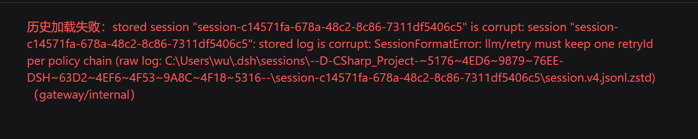
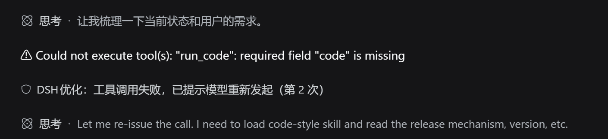
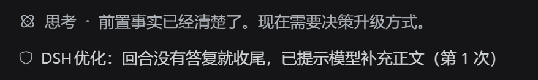
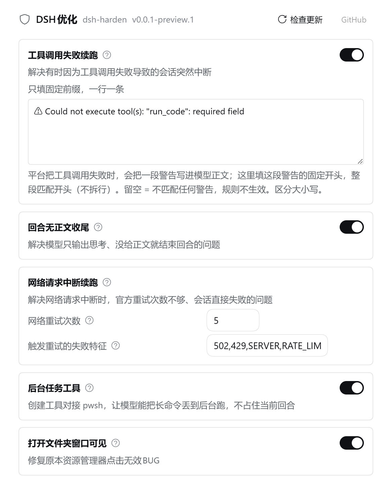
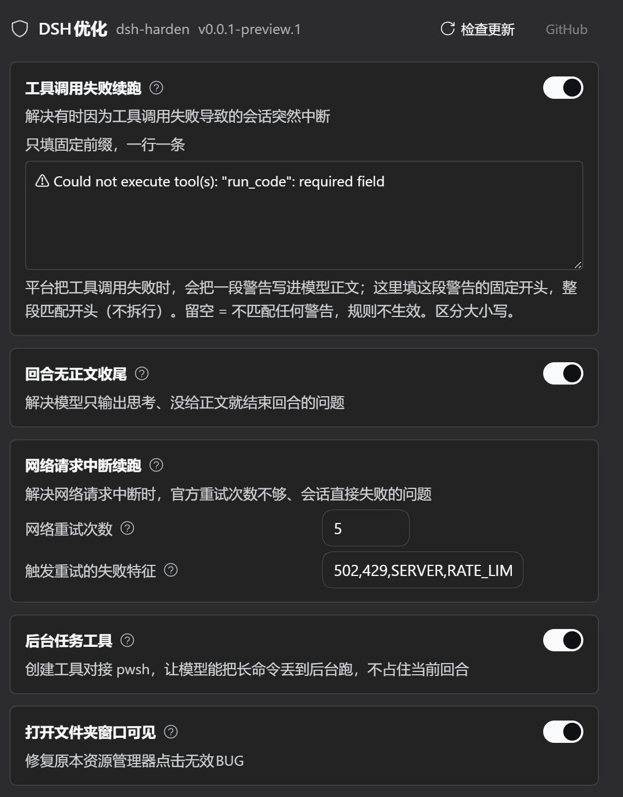

# dsh-harden

<p align="center">
  <a href="https://www.npmjs.com/package/dsh-harden"></a>
  <a href="https://github.com/thissensen/dsh-harden/actions/workflows/ci.yml"></a>
  <a href="https://github.com/thissensen/dsh-harden/releases"></a>
  <a href="./LICENSE"></a>
</p>

<p align="center">
  <b>DSH 运行时看护层 —— 让任何一次停止都有明确原因</b>
</p>

<p align="center">
  <a href="./README.en.md">English</a> ·
  <a href="https://github.com/thissensen/dsh-harden">GitHub</a>
</p>

## 兼容性

- **只支持 DSH 0.2.2-rc.1 及以上**：在 `dsh@0.2.2-rc.3` 上构建与用例通过；平台版本更低就别装。
- **还在用 DSH 0.2.1 的，请继续用 `0.0.3`**：那个版本会一直留在 npm 上，不会被撤下。
- **不做「有就用、没有就悄悄退回」的双轨**：这个版本用的是 0.2.2 才有的平台接口，装到旧平台上会直接报错，所以插件不探测平台版本，也没有降级路线。

## 插件用途

1. API由于特殊原因导致的调用失败后，可续接并自动重试

2. 工具调用失败被吞导致会话莫名结束（需在设置页填「失败提示前缀」，否则本条不生效）

3. 第三方API经常出现的：只输出思考直接中断，插件会自动重试

4. 创建对接pwsh的后台job工具，解决只使用gitbash无法创建超120秒的后台任务

5. 一键修复异常会话日志

6. 上下文自动压缩 —— 会话涨到阈值自动把老历史压成摘要，界面沿用平台自带提示；压缩范围另有下拉框三档可选（全部压缩 / 仅主代理 / 仅子代理，默认全部压缩）

7. 子代理通知聚合 —— 多个子代理并行结束时不再逐个唤醒主代理：中间通知先压住，全部结束后合并成一条统一送达（默认关闭，可在设置页打开）

8. 子代理会话异常自动修复 —— 解决子代理运行过程中莫名的会话无法打开情况；平台写出的重试事件不合规时，在落盘前先修正，修正发生时回合尾部显示一行浅色提示（**常驻开启，没有开关**）。修正痕迹同时写进会话日志，**重启后这行提示仍然显示**

9. 突破 PTC 120 秒限制 —— PTC 模式下 `run_code` 程序的默认预算从平台默认的 120 秒抬到计时器上限（约 24.8 天），关掉立即恢复；主代理与子代理都生效（**默认关闭**，预算这么大之后写坏的程序不会自己到点结束）

10. 旧认证 cookie 自动清理 —— 桌面端每次启动都会在同一地址上多攒一条认证 cookie，攒到浏览器请求头超出上限时页面直接打不开；插件在界面打开时清掉不属于当前页面的那些、只留当前页面这一条（**默认开启**；同时开着的另一个 DSH 实例会因它的 cookie 被删而掉线，需重开它的启动链接。阈值与生效条件见下面「设置页」表）

## 问题截图

会话日志被写坏后，平台会直接报错、整段历史再也打不开；插件在设置页提供一键扫描并修复：

<p align="center">
  
</p>

工具调用失败被吞时，插件自动提示模型重新发起，回合不会莫名结束：

<p align="center">
  
</p>

模型只输出思考、没有正文就收尾时，插件自动提示模型补充正文，回合不会莫名结束：

<p align="center">
  
</p>

## 插件截图

<p align="center">
  
  
</p>

## 安装

三条路选一条，装完还必须把插件注册到 profile —— 这一步是必须的（见下一节）。

### 1. 从 npm 安装

```bash
npm install dsh-harden
```

### 2. 从 GitHub Releases 下载

到 [Releases](https://github.com/thissensen/dsh-harden/releases) 下载 `dsh-harden-<版本>.tgz`：

```bash
dsh plugin --profile web add file:<tgz 文件的绝对路径>
```

### 3. 从源码构建

```bash
git clone https://github.com/thissensen/dsh-harden.git
cd dsh-harden
pnpm install
node scripts/link-deps.mjs    # 把宿主包链进本项目的 node_modules
pnpm build                     # tsc（host）+ vite（client）
```

首次构建必须在启动 DSH 之前完成（client 壳受启动快照约束）。

## 注册到 profile

上面三条路只是把文件放到位置，还得把 `dsh-harden` 注册进 profile，DSH 启动时才会加载它。

**桌面端**：手动改 `~/.dsh/profiles/desktop/package.json` 的两个地方：

1. 在 `dependencies` 里加 `"dsh-harden": "link:<克隆目录>/dsh-harden"`（从 npm 装的用版本范围）；
2. 在 `dsh.profile.bundles` 数组里加 `"dsh-harden"`。

然后在该目录跑 `pnpm install`，并**重启桌面端**（client 壳受启动快照约束）。

**Web 端**：一条 CLI 命令

```bash
dsh plugin --profile web add link:<克隆目录的绝对路径>
```

## 设置页

设置页在「DSH优化」分区下，卡片如下：

| 卡片 | 说明 |
|---|---|
| **工具调用失败续跑** | 开关。工具调用失败被吞、框架仍把回合当作正常结束时，注入一条提示让模型重新发起。另有 **失败提示前缀**：只填平台警告的固定开头，整段匹配开头（不拆行）、区分大小写；前缀以 ``<`` 开头时，正文里**成对出现**该标记（开+闭）也算失败。**默认空 —— 留空则规则 H1 不生效。** 例：`⚠ Could not execute tool`。 |
| **回合无正文收尾** | 开关。最后一步只有思考、既没有回复也没有工具调用的回合，会被拉回再走一步。 |
| **网络请求中断续跑** | 开关 + **网络重试次数**（官方重试耗尽后最多再补几次，0–99；填 0 表示不兜底）+ **触发重试的失败特征**（错误码 `SERVER` / `RATE_LIMIT` / `TIMEOUT` / `TRANSPORT` 与 HTTP 状态码 `502` / `429`；留空表示不重试任何失败）。 |
| **上下文自动压缩** | 开关 + **压缩范围**（下拉框：全部压缩 / 仅主代理 / 仅子代理，默认全部压缩）+ **触发阈值**（可以填绝对大小，如 `200K` / `1M` / `100000`；也可以填占模型上下文窗口的比例，如 `60%`，比例取 1%~100%；插件默认为 `200K`。绝对大小最多按模型窗口的 90% 算，填得比它还大也只按 90%）+ **摘要指令**（生成摘要时发给模型的指令）。会话超过阈值后，较早的一段历史被浓缩成摘要，并沿用平台自带的「上下文已压缩」提示。 |
| **后台任务工具** | 开关。开启后模型可以用 `job_background` 起后台命令，再用 `job_list` / `job_output` / `job_kill` 管理；关闭后该工具消失。 |
| **突破 PTC 120 秒限制** | 开关，**默认关闭**。打开后把 PTC 模式 `run_code` 程序的默认程序预算从 120 秒抬到平台计时器上限（2147483647 毫秒，约 24.8 天），主代理与子代理都生效；关闭或插件卸载时恢复平台默认的 120 秒。只动这一份预算：`gitbash` 前台命令的 600 秒上限、`job_output` 单次等待的 600 秒上限都不变。**预算抬这么高之后就没有自动兜底了** —— 死循环的程序几乎不会自己结束，只能你手动停；它也不是安全边界（改配置、别的插件、外部进程都能绕开）。 |
| **子代理通知聚合** | 开关，**默认关闭**。多个子代理并行结束时，中间通知先压住，全部结束后合并成一条统一送达，不再逐个唤醒模型。 |
| **子代理会话异常自动修复** | **没有开关，常驻开启。** 平台即将写入不合规的重试事件时，插件在落盘前先修正，会话因此不会变得打不开；修正发生时回合尾部显示一行浅色提示，修正痕迹写进会话日志，**重启后仍然显示**。 |
| **修复损坏会话** | 扫描按钮。扫描全部会话日志并修复已知的损坏形态，让打不开的历史重新可用。 |
| **旧认证 cookie 自动清理** | 开关，**默认开启**。每次打开界面时，同一地址上的认证 cookie 超过 20 条就把旧的删掉、只留当前页面这一条；不到 20 条什么都不做。**同时开着的另一个 DSH 实例（比如网页版）会因为它的 cookie 被删而掉线，需要重开启动链接。** 关掉这个开关后，桌面端每次启动都会重新攒一条，攒到约 68 条时浏览器请求头超出上限、页面直接打不开。只在 `127.0.0.1`、`localhost` 这类本机地址上生效；非本机地址下卡片会标一行「当前环境不生效」。 |

页头右侧还有 **「检查更新」**：点击后经插件自己的 host 端点去 npm 查最新版本（结果缓存 5 分钟）——有新版本时按钮**直接显示版本号**，点一下打开 npm 包页；离线或挂了代理时显示「检查失败，点击重试」，再点一次重跑。

> ⚠️ **最要紧的一条**：**「失败提示前缀」默认为空，装完不填，规则 H1 就不生效。** 请打开设置页，把你的平台警告原文的固定开头粘进去（例：`⚠ Could not execute tool`）。

> 设置页截图取自旧版本面板，与当前卡片文案不完全一致，以实际界面为准。

## 开发

```bash
pnpm install
node scripts/link-deps.mjs    # 把宿主包链进本项目的 node_modules
pnpm build                     # tsc（host）+ vite（client）
pnpm typecheck                 # 只做类型检查
pnpm test                      # vitest，用例见 tests/，必须全绿
```

## 设计

- **只挂平台公开事件。** 规则 H1（工具调用失败）与 H2（回合没有正文）挂在 serial 的 `agent/turn-stopping`：回合即将收尾时读最后一步的正文，命中就调 `agent.steer()` 把引导重新投回去。规则 H3（网络请求中断）挂在 waterfall 的 `agent/request-error`：先 `await next()` 让官方重试先决定，它放弃之后才接力。
- **看护不限次数。** 命中就注入纠正消息，不设上限；只留一个计数用于日志留痕。
- **没有就当不在场。** 读不出的配置一律回落默认值；可选服务缺席时插件照常挂载，不假装能用。
- **不改用户配置、不改平台包。** 开关存在平台的 `settings` 里，插件不写 `settings.yaml` / `cordis.patch.yml`；也不 patch 任何 `@deepseek-ai/*` 包。

## 许可

[MIT](./LICENSE)
